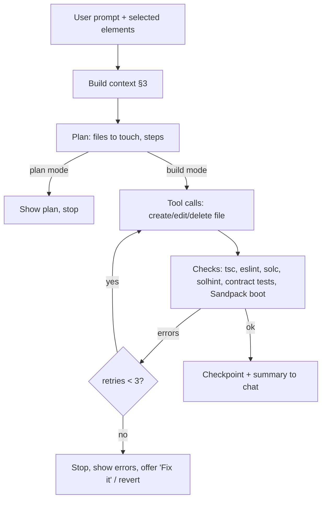

# AI agent (the "brain")

> **Challenge this doc.** Everything here is a proposal. Claude should challenge anything that is wrong or could be done better (recommendations, architecture, stack picks) with reasons, and record changes in [DECISIONS.md](DECISIONS.md) or raise them in [OPEN_QUESTIONS.md](OPEN_QUESTIONS.md). Only the user's D1–D4 are fixed, and even those can be flagged for the user to reconsider. **UNVERIFIED** marks unconfirmed facts.

What powers generation, editing, steering and self-repair, modelled on Lovable, bolt.diy, v0, Open Lovable and Cursor.

## 1. Models and routing
Calls go through GoodDollar AI credits if allowed, else the Vercel AI SDK with direct provider keys (D9, D18; no OpenRouter, no public Claude API without approval).
- GoodDollar AI credits = AntSeed (OpenAI/Anthropic-compatible buyer proxy/gateway). GoodDollar's own hosted proxy/API keys are NOT yet implemented. Proposed: AntSeed gateway as a LiteLLM OpenAI-compatible provider, fallback to direct providers on 402/502. Deferred (P3); GoodBuild uses its own credits (D11, [CREDITS.md](CREDITS.md)): LiteLLM callback debits the ledger at a markup, preflight reserve, streaming cutoff.
| Task | Tier | Candidates (check current pricing) |
|---|---|---|
| First build, multi-file features, contract code | Strong coding model | Claude Sonnet/Opus, GPT-5-class, Gemini Pro |
| Small edits, select-to-edit, copy changes, summaries | Cheap/fast | Claude Haiku, Gemini Flash/Flash-Lite, DeepSeek |
| Auto-fix of compile/type errors | Cheap first, escalate to strong after 1 failure | |
| Plan mode / chat | Cheap or mid | |
- **Prices change often; not quoted here.** Pull from provider pages at build time (anthropic.com/pricing, openai.com/api/pricing, ai.google.dev/pricing, api-docs.deepseek.com) and LiteLLM's model cost map. Cost per generated app is UNKNOWN (Q6) → measure with the benchmark (§8).
- Router rule (proposal): classify request size by files touched + intent; fallback model on provider error via LiteLLM; per-user budget caps in LiteLLM.
- Use prompt caching (system prompt + template files) where provider supports it.

## 2. Agent loop

- **Tools (function calling):** `read_file`, `create_file`, `edit_file` (search/replace blocks), `delete_file`, `rename_file`, `add_dependency` (allowlisted packages only), `list_files`. No shell (Sandpack has none).
- **Diff-based edits, not full rewrites.** Search/replace blocks (Aider/Cursor style) with exact-match + fuzzy fallback; full rewrite only for new or tiny files. Reference points: bolt.diy writes full files via `<boltAction type="file">` ([prompt](https://github.com/stackblitz-labs/bolt.diy/blob/main/app/lib/common/prompts/new-prompt.ts)); bolt.new and v0 offer diff edits to save tokens (bolt as a feature preview, may fail; source: [YouTube guide](https://www.youtube.com/watch?v=0_Ij8FEvY4U), weak source). Open Lovable's exact edit format UNVERIFIED (read repo before borrowing, D6).
- **Retry cap:** 3 auto-fix attempts per turn, then escalate model once, then hand to user. Don't count against user credits after a platform error *(proposal)*.
- Stream tokens and file actions to the UI ("visible tasks", like Lovable).

## 3. Context management
- **Always in context:** system prompt, pinned **project brief** (goal, audience, contract template + params, design tokens, decisions; user-editable, like Lovable "Knowledge"), file tree with one-line summary per file, ABI + deployed addresses.
- **Selected per turn:** files ranked by (1) explicitly selected element's source file, (2) files named in the prompt, (3) import graph neighbours, (4) recency, (5) embedding/keyword match. bolt.diy context mode picks ~5 files (secondary source, UNVERIFIED).
- **Conversation:** last N turns verbatim + rolling summary of older turns.
- **Budget** *(starting numbers to tune)*: system+brief ≤ 6K tokens, tree ≤ 2K, files ≤ 40K, history ≤ 8K, leave ≥ 8K for output. Summaries refreshed by cheap model on file change.

- **Implemented (P17):**
  - The context block holds a manifest of every file (path, size, a one-line summary computed from the code) and the files picked for the request (`selectContext` in `codebase.ts`). A project that fits the 40k-char budget is sent whole. Otherwise the block takes the entry, the theme, contracts and the assets module first, then files that match the request by path, symbol and text, then last turn's changes, import neighbours, and small starter files with what budget is left.
  - Tools: `search_code`, `find_symbol` and `read_file` with line ranges. Every read and search is logged.
  - History: the last 8 messages verbatim, plus a rolling memory (`memory.ts`, `projects.memory`) of older ones, made of a summary and the user's decisions as a list.
  - No embeddings; [evals/HARNESS.md](evals/HARNESS.md) has the measurements.

## 4. Correction and steering
- **Select-to-edit:** click element(s) in the preview → attaches component file + line + DOM snippet to the prompt. Lovable does this via its preview toolbar (select elements, inline text edit, annotations) ([docs](https://docs.lovable.dev/features/preview-toolbar)). Implementation: Babel/Vite-style plugin adds `data-gb-src="file:line"` to JSX in Sandpack; an iframe script reports clicks via postMessage. Inline text edits can be applied without a model call.
- **Checkpoints per prompt:** each agent turn = one version (file snapshot/diff in DB). Lovable saves a version per change with revert ([summary](https://aliteq.com/undo-ai-changes)); Cursor checkpoints restore files but not chat and are not a substitute for git (same source). Our revert restores files; chat stays and logs "reverted to v12". **Revert never touches deployed contracts** (show this clearly).
- **Branch:** "fork from this version" creates a new project branch (like Lovable Remix). Later: export to GitHub.
- **Plan first (D32):** a project's first message gets a few plain questions as cards, a palette choice and a summary with Start building, then builds with those answers in its context. One cheap call, no files. See `plan-intake.ts`, `plan-first.ts`, `src/lib/palettes.ts` and `plan-card.tsx`.
- **Plan mode vs build mode:** plan mode answers and drafts a plan but never edits files (Lovable glossary: [docs](https://docs.lovable.dev/glossary)); build mode executes. Follow-ups while running are queued on the server and run in order (P18); Stop cancels them, and they stay in the chat to resend.
- Chat history stored per project (D8).

## 5. Multi-page apps
- Implemented (P14): react-router-dom 6.30.6 with `HashRouter` (base dependency; the preview and static hosting have no server routes). Route table in `src/App.tsx`, pages in `src/pages/*.tsx`, shared `src/components/Layout.tsx` (nav, wallet button, outlet, footer). The `pages-and-routing` guide tells the agent to add page, route and nav link in one turn.
- Not yet: a page list or route switcher in the preview toolbar (navigate inside the preview for now).

## 6. UI quality
- **Design system:** shadcn/ui + Tailwind + React Bits (D7), pre-installed in the template so the model composes, not invents. Theme tokens as CSS variables (`--primary`, radius, font) in the brief; "make it greener" edits tokens, not components.
- **Prompts:** component catalog (names + when to use) in system prompt; rules: mobile-first, accessible labels, loading/empty/error states for every contract call, no lorem ipsum.
- **Starter (P13):** `src/App.tsx` is a layout-free placeholder the first build replaces, so the model designs the page for the request instead of copying a stock header and card. Helpers it composes: `lib/format.ts` (`formatAmount`, `errorMessage`), `lib/hooks.ts` (`useRead` for reads with loading/error, `useTx` for wallet writes), `ui/{skeleton,notice,textarea}` beside button, card, input, label, badge. Older projects get missing helpers backfilled (never overwritten) at the start of a turn. The system prompt's design rules ask for a layout that fits the app, real copy, a per-app accent colour in `public/index.html`, and one or two next steps as clickable chips (P15, `suggest_next`) after each build, plan or answer. Fix passes are quiet and build-mode narration that comes with tool calls is dropped, so that reply stays last; a pass that runs out of tool rounds or shows nothing gets one more call for the reply, and no-op edits are reported to the model as no change.
- **Guides (P14):** detailed front-end know-how lives in `src/server/agent/guides.ts` and is loaded on demand (via `set_plan`'s `guides` or `read_guide`), so the base prompt stays small. Websites without contracts are in scope (D20).
- **Contract tests (P16):** `contracts/test/*.t.sol` runs in a local EVM after each clean compile (`src/server/agent/contract-tests.ts`, `scripts/evm-test.mjs`, helpers in `scripts/solidity/goodbuild/`). Failures go to auto-fix. Evals of complex prompts live in `docs/evals/`.
- **Assets (P17, implemented):**
  - Logos, images and design references are uploaded from the composer (`/api/projects/[id]/assets`), type-sniffed, sanitised if SVG, and stored in `project_assets` behind `AssetStore`.
  - Code references them as `/assets/<name>`, or through the platform-written `src/assets/index.ts`. The preview inlines them as data URLs, so there are no base64 blobs in project files.
  - Each upload gets a palette and a one-time description from the cheap model, which reads images. A reference is described as a layout spec, and its image is attached to the next turn.
  - Guides: `brand-and-assets` and `match-reference`.
  - Generated images (an image model) are not built. Icons come from lucide-react, which has no brand icons; the app check enforces real icon names.
- **Kits (D71, implemented):** each further kind of app (games, dashboards) is a kit: packages, starter files, a guide, file types and checks in one module under `src/server/agent/kits/`. The builder turns one on with `add_kit`.
- **Type check and `run_checks` (D68, implemented):** TypeScript over the app (`TYPE_CHECK=warn` notes errors, `enforce` sends them to auto-fix), and a tool that lets the builder run every check itself, up to 3 times a turn, and fix what it finds before replying. See `type-check.ts`.
- **Run check (D67, implemented):** after the other checks pass, the server builds the app, opens it in a headless browser and sends crashes, an empty page or a page that throws to auto-fix as `[runtime]` errors. See `run-check.ts`.
- **Checks:** preview at 375px and 1280px; **screenshot self-review (optional)** using a vision model on a captured iframe (capture of Sandpack iframe e.g. html-to-image: feasibility UNVERIFIED). Lovable has browser testing with screenshots ([glossary](https://docs.lovable.dev/glossary)).

## 7. Error handling
- Sandpack compile + runtime errors and `console.error` captured via its client listener → shown with a **"Fix it"** button that sends error, stack and file to the agent (cheap model first).
- Contract errors (solc, revert reasons from simulation) handled the same way.
- Detect loops: same error twice after fix → stop and ask.

## 8. Evaluation
**Implemented (D70):** the suite is in [evals/SUITE.md](evals/SUITE.md) and runs on demand in CI. The paragraph below is the original proposal.

Small benchmark (~20 prompts) run on every prompt/model change; scored for: compiles, Sandpack boots, contract tests pass, deploys to Celo Sepolia, flows work (scripted), UI score (rubric or vision judge), tokens + cost, turns to fix. Examples: "G$ tip jar for my campus club", "class voting for verified students", "ajo savings circle for 5 friends", "NFT event badges", "crowdfund with refund", plus 5 edit prompts ("add a leaderboard page", "make the button bigger") and 3 failure prompts (vague, unsafe: "contract that lets me take everyone's funds").

## Open choices (Claude's input invited)
Q13–Q16 in [OPEN_QUESTIONS.md](OPEN_QUESTIONS.md).

## Implementation (M4)
- **Models:** the Vercel AI SDK (D18) in `src/server/agent/model.ts`: `claude-sonnet-5-5` (`@ai-sdk/anthropic`) for fixes (D19), `deepseek-flash` (`@ai-sdk/deepseek`, an alias for the current V4 Flash, see Q34) for planning, the first build and as fallback. The SDK retries once; `withFallback` then retries a strong call on cheap only if nothing has streamed yet. Keys come from `ANTHROPIC_API_KEY` and `DEEPSEEK_API_KEY`. The system prompt is cache-marked for Anthropic.
- **Loop:**
  - `src/server/agent/runner.ts` runs plan (`set_plan`), tool edits (`src/server/agent/workspace.ts`), checks (`checks.ts`), up to 3 auto-fixes and one checkpoint per prompt (`store.ts`).
  - Turns run as background jobs (P18): `src/server/jobs/`, with tables `turn_jobs`, `turn_job_calls` and `turn_events`. A worker claims a job with a lease. One turn per project runs at a time; follow-ups queue on the server in send order.
  - The turn is resumable. Setup is saved once, each model response is committed with its usage, and a crashed turn is resumed by replaying those responses.
  - Stop takes effect at the next safe point, saves nothing, and cancels queued follow-ups.
- **Edits:** search/replace with exact match, then a whitespace-tolerant unique match (`edits.ts`).
- **Platform-owned files:** after each compile GoodBuild writes `src/contracts/<Name>.ts` (ABI; addresses after deploy in M5). The agent can read but not edit them.
- **Billing data:** every model call is stored in `usage_events`, priced with `src/config/model-pricing.ts` at cost + 25% (D13). M6 debits from these rows.
- **Streaming:**
  - `POST /api/projects/[id]/turns` queues the turn and returns a job id.
  - `GET /api/projects/[id]/turns/[jobId]/events?after=seq` streams numbered Server-Sent Events from `turn_events` (`id:` lines, `event: end` when the job is over). The stream closes every 60 s and the client reconnects with backoff.
  - A reload replays the events from the start. After a resume, a `snapshot` event replaces the half-finished view.
  - `POST /api/projects/[id]/turns/[jobId]/stop` stops the turn.
  - The turn runs and persists whether or not any browser is watching.
- **Offline demo:** `GOODBUILD_DEMO_MODEL=1` asks plan-first questions (website ones for a website), then replays a scripted tip-jar build or a one-page site (development only).

## Project names
On a project's first build, a cheap call with no thinking (`nameProject`, `src/server/agent/project-name.ts`) gives it a short name, numbered if the owner already has one like it. It runs beside the build and counts as usage. If it fails or the reply isn't a name, the name made from the prompt stays.
