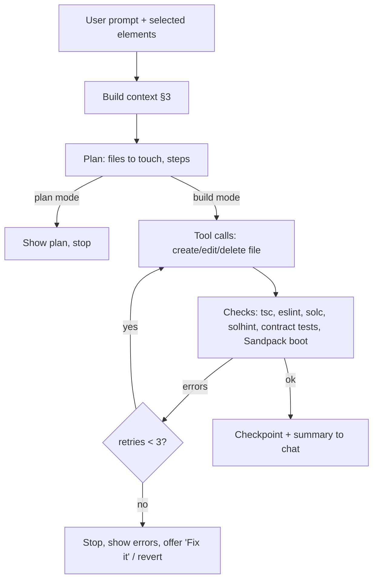

# AI agent (the "brain")

> **Challenge this doc.** Everything here is a proposal. Claude should challenge anything that is wrong or could be done better (recommendations, architecture, stack picks) with reasons, and record changes in [DECISIONS.md](DECISIONS.md) or raise them in [OPEN_QUESTIONS.md](OPEN_QUESTIONS.md). Only the user's D1–D4 are fixed, and even those can be flagged for the user to reconsider. **UNVERIFIED** marks unconfirmed facts.

What powers generation, editing, steering and self-repair, modelled on Lovable, bolt.diy, v0, Open Lovable and Cursor.

## 1. Models and routing
Calls go through GoodDollar AI credits if allowed, else LiteLLM (D9; no OpenRouter, no public Claude API without approval).
- GoodDollar AI credits = AntSeed (OpenAI/Anthropic-compatible buyer proxy/gateway). GoodDollar's own hosted proxy/API keys are NOT yet implemented. Proposed: AntSeed gateway as a LiteLLM OpenAI-compatible provider, fallback to direct providers on 402/502. Deferred (P3); GoodBuild uses its own credits (D11, [CREDITS.md](CREDITS.md)): LiteLLM callback debits the ledger at a markup, preflight reserve, streaming cutoff.
| Task | Tier | Candidates (check current pricing) |
|---|---|---|
| First build, multi-file features, contract code | Strong coding model | Claude Sonnet/Opus, GPT-5-class, Gemini Pro |
| Small edits, select-to-edit, copy changes, summaries | Cheap/fast | Claude Haiku, Gemini Flash/Flash-Lite, DeepSeek |
| Auto-fix of compile/type errors | Cheap first, escalate to strong after 1 failure | |
| Plan mode / chat | Cheap or mid | |
- **Prices change often; not quoted here.** Pull from provider pages at build time (anthropic.com/pricing, openai.com/api/pricing, ai.google.dev/pricing, api-docs.deepseek.com) and LiteLLM's model cost map. Cost per generated app is UNKNOWN (Q6) → measure with the benchmark (§8).
- Router rule (proposal): classify request size by files touched + intent; fallback model on provider error via LiteLLM; per-user budget caps in LiteLLM.
- Use prompt caching (system prompt + template files) where provider supports it.

## 2. Agent loop

- **Tools (function calling):** `read_file`, `create_file`, `edit_file` (search/replace blocks), `delete_file`, `rename_file`, `add_dependency` (allowlisted packages only), `list_files`. No shell (Sandpack has none).
- **Diff-based edits, not full rewrites.** Search/replace blocks (Aider/Cursor style) with exact-match + fuzzy fallback; full rewrite only for new or tiny files. Reference points: bolt.diy writes full files via `<boltAction type="file">` ([prompt](https://github.com/stackblitz-labs/bolt.diy/blob/main/app/lib/common/prompts/new-prompt.ts)); bolt.new and v0 offer diff edits to save tokens (bolt as a feature preview, may fail; source: [YouTube guide](https://www.youtube.com/watch?v=0_Ij8FEvY4U), weak source). Open Lovable's exact edit format UNVERIFIED (read repo before borrowing, D6).
- **Retry cap:** 3 auto-fix attempts per turn, then escalate model once, then hand to user. Don't count against user credits after a platform error *(proposal)*.
- Stream tokens and file actions to the UI ("visible tasks", like Lovable).

## 3. Context management
- **Always in context:** system prompt, pinned **project brief** (goal, audience, contract template + params, design tokens, decisions; user-editable, like Lovable "Knowledge"), file tree with one-line summary per file, ABI + deployed addresses.
- **Selected per turn:** files ranked by (1) explicitly selected element's source file, (2) files named in the prompt, (3) import graph neighbours, (4) recency, (5) embedding/keyword match. bolt.diy context mode picks ~5 files (secondary source, UNVERIFIED).
- **Conversation:** last N turns verbatim + rolling summary of older turns.
- **Budget** *(starting numbers to tune)*: system+brief ≤ 6K tokens, tree ≤ 2K, files ≤ 40K, history ≤ 8K, leave ≥ 8K for output. Summaries refreshed by cheap model on file change.

## 4. Correction and steering
- **Select-to-edit:** click element(s) in the preview → attaches component file + line + DOM snippet to the prompt. Lovable does this via its preview toolbar (select elements, inline text edit, annotations) ([docs](https://docs.lovable.dev/features/preview-toolbar)). Implementation: Babel/Vite-style plugin adds `data-gb-src="file:line"` to JSX in Sandpack; an iframe script reports clicks via postMessage. Inline text edits can be applied without a model call.
- **Checkpoints per prompt:** each agent turn = one version (file snapshot/diff in DB). Lovable saves a version per change with revert ([summary](https://aliteq.com/undo-ai-changes)); Cursor checkpoints restore files but not chat and are not a substitute for git (same source). Our revert restores files; chat stays and logs "reverted to v12". **Revert never touches deployed contracts** (show this clearly).
- **Branch:** "fork from this version" creates a new project branch (like Lovable Remix). Later: export to GitHub.
- **Plan mode vs build mode:** plan mode answers and drafts a plan but never edits files (Lovable glossary: [docs](https://docs.lovable.dev/glossary)); build mode executes. Follow-ups while running are queued to the next stop point.
- Chat history stored per project (D8).

## 5. Multi-page apps
- Template uses React Router: `src/routes.tsx` (route table), `src/layouts/AppLayout.tsx` (nav + wallet button + outlet), `src/pages/*.tsx`.
- UI shows a page list from the route table; "Add page" or prompt "add a leaderboard page" → agent creates page, adds route + nav entry in one turn. Preview has a route switcher. Use HashRouter or SPA fallback for static hosting.

## 6. UI quality
- **Design system:** shadcn/ui + Tailwind + React Bits (D7), pre-installed in the template so the model composes, not invents. Theme tokens as CSS variables (`--primary`, radius, font) in the brief; "make it greener" edits tokens, not components.
- **Prompts:** component catalog (names + when to use) in system prompt; rules: mobile-first, accessible labels, loading/empty/error states for every contract call, no lorem ipsum.
- **Assets:** user uploads stored and referenced by URL; generated images via image model (optional); icons from lucide-react. No base64 blobs in code.
- **Checks:** preview at 375px and 1280px; **screenshot self-review (optional)** using a vision model on a captured iframe (capture of Sandpack iframe e.g. html-to-image: feasibility UNVERIFIED). Lovable has browser testing with screenshots ([glossary](https://docs.lovable.dev/glossary)).

## 7. Error handling
- Sandpack compile + runtime errors and `console.error` captured via its client listener → shown with a **"Fix it"** button that sends error, stack and file to the agent (cheap model first).
- Contract errors (solc, revert reasons from simulation) handled the same way.
- Detect loops: same error twice after fix → stop and ask.

## 8. Evaluation
Small benchmark (~20 prompts) run on every prompt/model change; scored for: compiles, Sandpack boots, contract tests pass, deploys to Celo Sepolia, flows work (scripted), UI score (rubric or vision judge), tokens + cost, turns to fix. Examples: "G$ tip jar for my campus club", "class voting for verified students", "ajo savings circle for 5 friends", "NFT event badges", "crowdfund with refund", plus 5 edit prompts ("add a leaderboard page", "make the button bigger") and 3 failure prompts (vague, unsafe: "contract that lets me take everyone's funds").

## Open choices (Claude's input invited)
Q13–Q16 in [OPEN_QUESTIONS.md](OPEN_QUESTIONS.md).

## Implementation (M4)
- **Models:** the app calls the LiteLLM proxy (`litellm/config.yaml`) with two aliases: `gb-strong` (`anthropic/claude-sonnet-5-5`) and `gb-cheap` (DeepSeek Flash, see Q34). LiteLLM retries once, then falls back from strong to cheap. Run locally with `pnpm llm`.
- **Loop:** `src/server/agent/runner.ts`. Plan (`set_plan`), tool edits (`src/server/agent/workspace.ts`), checks (`checks.ts`), up to 3 auto-fixes (cheap model first), one checkpoint per prompt (`store.ts`). One turn per project at a time; follow-ups queue in the browser.
- **Edits:** search/replace with exact match, then a whitespace-tolerant unique match (`edits.ts`).
- **Platform-owned files:** after each compile GoodBuild writes `src/contracts/<Name>.ts` (ABI; addresses after deploy in M5). The agent can read but not edit them.
- **Billing data:** every model call is stored in `usage_events`, priced with `src/config/model-pricing.ts` at cost + 25% (D13). M6 debits from these rows.
- **Streaming:** `POST /api/projects/[id]/turns` returns Server-Sent Events. The turn finishes and persists even if the browser disconnects.
- **Offline demo:** `GOODBUILD_DEMO_MODEL=1` replays a scripted tip-jar build (development only).
