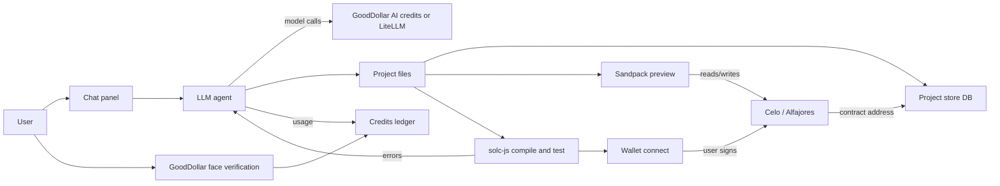

# Architecture (Stage 1, dApps only)

Draft. Stack choices marked *(suggestion)* are not decided.

## Components
1. **Chat panel**: user describes the app; shows plan, diffs and errors.
2. **LLM file-generation agent**: turns chat into a file set (Solidity contract(s), React app, tests) and edits files on follow-ups. Calls models via GoodDollar AI credits or LiteLLM (D9).
3. **Sandpack preview**: runs the generated React front end in the browser (D5).
4. **Solidity compile and test**: solc-js in the browser compiles contracts; errors go back to the agent to fix. Tests *(suggestion: run in-browser against a local EVM such as a JS EVM; approach UNVERIFIED)*.
5. **Wallet connect and deploy**: user connects a wallet and signs the deploy transaction to Celo Alfajores (testnet) or Celo mainnet. The address is saved to the project.
6. **GoodDollar identity**: face-verification via `@goodsdks/citizen-sdk` (`getWhitelistedRoot`, `generateFVLink`) to gate free credits and count verified users.
7. **Credits ledger**: tracks generation credits per user (and per GoodID root for free credits).
8. **Project store**: DB of projects, files, chat history, deployments (D8).

## Data flow

## Suggested stack *(all suggestions)*
| Layer | Suggestion |
|---|---|
| Web app | Next.js (App Router), TypeScript |
| Generated apps | React + Vite template, shadcn/ui + React Bits (D7) |
| Preview | Sandpack |
| Contracts | solc-js in browser; OpenZeppelin imports |
| Wallet | wagmi/viem + a social-login wallet (thirdweb or Privy; Celo support UNVERIFIED) |
| Identity | `@goodsdks/citizen-sdk` |
| DB | Postgres |
| Models | LiteLLM proxy with per-user budgets, or GoodDollar AI credits |
