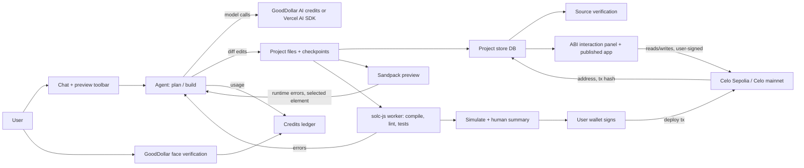

# Architecture (Stage 1, dApps only)

Draft. Stack choices marked *(suggestion)* are not decided. Claude should challenge any choice here with reasons (see [CLAUDE.md](../CLAUDE.md)).

Detail docs: [AI agent](AI_AGENT.md) · [Contracts and deployment](CONTRACTS_AND_DEPLOYMENT.md)

## Components
1. **Chat panel**: user describes the app; shows plan, diffs and errors.
2. **LLM file-generation agent** ([AI_AGENT.md](AI_AGENT.md)): plans, then makes diff-based tool edits, runs checks and auto-fixes; turns chat into a file set (Solidity contract(s), React app, tests) and edits files on follow-ups. Calls models via GoodDollar AI credits or the Vercel AI SDK (D9, D18).
3. **Sandpack preview**: runs the generated React front end in the browser (D5).
4. **Solidity compile and test**: solc-js in the browser compiles contracts; errors go back to the agent to fix. Tests *(suggestion: run in-browser against a local EVM such as a JS EVM; approach UNVERIFIED)*.
5. **Wallet connect and deploy** ([CONTRACTS_AND_DEPLOYMENT.md](CONTRACTS_AND_DEPLOYMENT.md)): compile → simulate → human summary → user connects a wallet and signs the deploy transaction to Celo Sepolia testnet (chainId 11142220; Alfajores retired Sep 2025) or Celo mainnet. The address is saved to the project.
6. **GoodDollar identity**: face-verification via `@goodsdks/citizen-sdk` (`getWhitelistedRoot`, `generateFVLink`) to gate free credits and count verified users.
7. **Credits ledger**: tracks generation credits per user (and per GoodID root for free credits).
8. **Project store**: DB of projects, versions/checkpoints, chat history, deployments, wallet→projects (D8).
9. **Interaction panel**: auto-generated from the ABI after deploy; generated front end wired to the address.

9. **Auth gate** ([AUTH.md](AUTH.md)): Send requires a connected wallet and a SIWE session. A pending prompt is preserved across the connect modal. The server checks the session on every agent, compile and credit call.

## Data flow

## Suggested stack *(all suggestions)*
| Layer | Suggestion |
|---|---|
| Web app | Next.js (App Router), TypeScript |
| Generated apps | React + Vite template, shadcn/ui + React Bits (D7) |
| Preview | Sandpack |
| Contracts | solc-js in browser; OpenZeppelin imports |
| Wallet / auth | Magic (email embedded wallet) plus MetaMask, MiniPay/Valora and WalletConnect, one viem wallet client for deploys, SIWE session cookie. See [AUTH.md](AUTH.md) (D22) |
| Identity | `@goodsdks/citizen-sdk` |
| DB | Postgres |
| Models | Vercel AI SDK in the Next.js server (Anthropic + DeepSeek, D18), or GoodDollar AI credits |

## Credits (D11)
GoodBuild's own credits: G$ → `GoodBuildCreditsVault` (Celo) → indexer → Postgres ledger → provider spend priced in our own code (`model-pricing.ts`). Components added: vault contract, indexer worker, billing service, treasury multisig. See [CREDITS.md](CREDITS.md).
