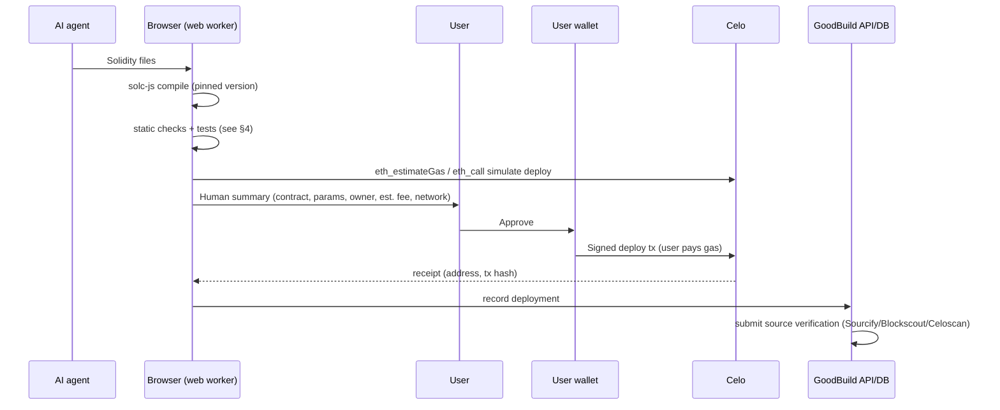
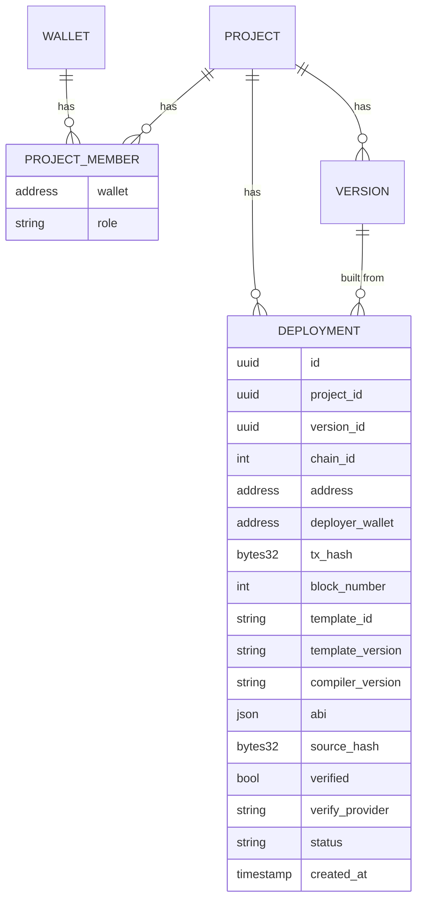

# Contracts and deployment (Stage 1)

> **Challenge this doc.** Everything here is a proposal. Claude should challenge anything that is wrong or could be done better (recommendations, architecture, stack picks) with reasons, and record changes in [DECISIONS.md](DECISIONS.md) or raise them in [OPEN_QUESTIONS.md](OPEN_QUESTIONS.md). Only the user's D1–D4 are fixed, and even those can be flagged for the user to reconsider. **UNVERIFIED** marks unconfirmed facts.

Principle: **we build, the user signs.** GoodBuild compiles and prepares the deploy transaction; the user's own wallet signs and pays gas. The platform never holds keys (CLAUDE.md rule 7). This is "deploy on behalf" without custody.

## 1. Wallet connect and identity
- **Library:** wagmi + viem (Celo chains built in to viem). UI kit: RainbowKit *or* Reown AppKit (Reown adds email/social login). Pick one; see Q10.
- **Newcomers:** social/email-login embedded wallets (Reown AppKit, thirdweb, Privy, Dynamic). Celo support per vendor **UNVERIFIED**; check before choosing. Must stay non-custodial or user-controlled (MPC/passkey); vendor custody model to be reviewed.
- **MiniPay:** later (Q5). MiniPay injects a provider; detect `window.ethereum.isMiniPay` (per Celo docs, re-check).
- **GoodDollar face verification:** `@goodsdks/citizen-sdk` → `getWhitelistedRoot(address)`; if not verified, `generateFVLink`. Gate: free credits and mainnet deploys *(proposal)*; testnet deploys open to all so newcomers can try before verifying.

## 2. Deploy flow

- **Compile:** solc-js (`soljson` wasm) in a Web Worker so the UI stays responsive; pin compiler version per template. Resolve OpenZeppelin imports from a vendored, version-pinned copy (not live npm) for reproducibility.
- **Simulate:** `eth_estimateGas` + `eth_call` of the creation tx with constructor args via viem. Catch reverts before the user pays.
- **Human-readable summary:** "Deploy *GoodTipJar v1.2* on *Celo Sepolia*. Owner: *your wallet 0x12…ab*. Token: G$. Est. fee ≈ 0.00x CELO." Show "unaudited" badge for any non-template code.
- **Sign:** `walletClient.deployContract({abi, bytecode, args})` (or `sendTransaction` with prepared data). The deployer is the user, so `msg.sender`/`Ownable` owner = user by default.
- **Networks:** testnet first by default, mainnet behind an explicit switch (and FV gate). **Testnet is Celo Sepolia (chainId 11142220). Alfajores was retired 30 Sep 2025** ([Celo docs](https://docs.celo.org/operate/notices/archive/celo-sepolia-launch)). Mainnet chainId 42220. (Fixes Q2/ARCHITECTURE references to Alfajores.)
- **Gas / fee currency:** Celo fee abstraction lets a tx set `feeCurrency` to an allowlisted token (CIP-64, tx type 0x7b). Allowlist includes cUSD/USDm, USDC and USD₮ (6-decimal tokens via *adapter* addresses) ([fee currencies](https://docs.celo.org/build/tools/contracts/fee-currencies), [using fee abstraction](https://docs.celo.org/build/fee-abstraction/using-fee-abstraction)). **G$ is not on the Celo Sepolia allowlist as listed (checked 4 Nov 2026); mainnet G$ as fee currency UNVERIFIED, assume no.** Read the live list from `FeeCurrencyDirectory.getCurrencies()`. Wallet support for `feeCurrency` varies (MiniPay yes per Celo; MetaMask **UNVERIFIED/likely no**). Default: pay in CELO; offer stablecoin where the wallet supports it. Testnet CELO from the Celo faucet.
- **Sponsored gas (later, optional):** ERC-4337 paymaster or a relayer funded from grants. Still user-signed; adds cost and abuse risk. See Q12.

## 3. Ownership mapping
Off-chain (source of truth for the app, D8):

- **wallet → projects** via `project_member` (role owner/editor). Login = SIWE (EIP-4361) so the wallet proves ownership; no passwords.
- Write the row only after the receipt; also re-derive from chain (tx hash → receipt) so a lost API call can be repaired. `deployer_wallet` must equal the session wallet.
- `source_hash` = hash of the exact compiled sources + settings, so "is this deployment the current code?" is answerable.

**Optional on-chain registry / factory** *(proposal, Q11)*:
| Option | Pros | Cons |
|---|---|---|
| DB only | Simple, free, no extra contract | Not publicly provable; doesn't show as GoodBuild activity on-chain |
| Registry contract: user calls `register(project, addr)` after deploy (emits event) | Public index; counts as an extra tx from a verified user | Extra tx/gas; spammable (filter by FV root) |
| Factory (CREATE2) per template: user calls `factory.create(params)` | One tx; event per deploy; deterministic addresses; cheap clones (EIP-1167) | Only for templates; factory is a shared, audit-critical contract; clones complicate source verification |
- On-chain events make deploys measurable for GoodBuilders on-chain metrics (txs, verified users). **Whether GoodDollar counts these UNVERIFIED** (ask, Q9).
- Lean: DB-only in week 1–4; factory for top templates once stable.

**Source verification:** submit to Sourcify (open, works with Blockscout) and Celoscan (Etherscan v2 multichain API key) after deploy. Sourcify/Blockscout support for Celo Sepolia **UNVERIFIED**; check. Store standard-JSON input so verification is reproducible.

## 4. Contract quality
**Audited-template-first.** The AI picks a template and fills parameters; custom logic only in marked extension points.
- **Bases:** OpenZeppelin Contracts v5 (audited; Wizard shows idiomatic composition: https://wizard.openzeppelin.com), thirdweb contracts (audited, prebuilt) as reference. Pin versions.
- **v1 catalog** *(proposal)*:
| Template | Base | Notes |
|---|---|---|
| ERC-20 token | OZ ERC20 (+Permit, Burnable) | capped supply option |
| NFT / badge | OZ ERC721/1155 | soulbound option for attendance |
| DAO / voting | OZ Governor + Votes, or simple poll | simple poll first |
| Escrow | custom on OZ ReentrancyGuard, SafeERC20 | milestone release |
| Crowdfund | custom | goal + deadline + refund |
| Savings circle (ajo/esusu/ROSCA) | custom | high-risk logic; extra tests |
| Tipping / tip jar | custom | G$ default token |
| G$ integrations | uses G$ ERC-677 `transferAndCall`, Identity/FV check | e.g. "verified humans only" modifier; addresses per GoodDollar docs |
- **Guardrails (blocklist, enforced by compiler-AST check):** no `delegatecall`, `selfdestruct`, inline `assembly`, `tx.origin` auth, `call` with arbitrary data; owner-controlled fund drains flagged; pragma pinned.
- **House rules (D15, enforced):** custom errors only; for G$ projects, G$ is the ERC-20 (no `msg.value`/`payable`), accepted via `onTokenTransfer` (with a `msg.sender` check) or `safeTransferFrom`, with SafeERC20 for every transfer.
- **Static analysis:** solhint rules in browser (JS; feasible). Slither is Python → **not in-browser**; run on a small server worker (feasible, but it adds a server, ~seconds per run) or Pyodide (**UNVERIFIED**). Aderyn (Rust) is an alternative (**UNVERIFIED** wasm).
- **Tests:** AI generates tests per template (template ships golden tests too). Options: (a) browser EVM (@ethereumjs/vm or Tevm) running deploy + calls in a worker (feasible; **UNVERIFIED** performance); (b) Foundry `forge test` in a cloud worker (strongest, needs a server); (c) Hardhat server. Proposal: (a) for every build, (b) before mainnet.
- **Upgradeability:** **non-upgradeable by default** (simpler, no admin-key risk for newcomers). Upgrades = redeploy a new version (§5). A testnet-only, per-project trial of OpenZeppelin's transparent proxy exists (D33, §6).
- **Free-form custom contracts:** allowed only on testnet in Stage 1 *(proposal)*; mainnet requires typed confirmation, "UNAUDITED – may lose funds" warning, and optional value caps in generated code.

## 5. After deploy
- **Interaction panel auto-generated from the ABI:** view/pure functions as read cards (auto-refresh), non-payable/payable as forms with typed inputs (address, uint with decimals helper, bool), each write going through simulate → summary → sign. Events feed via `getLogs`/`watchContractEvent`. (Similar to Etherscan "Read/Write Contract" or thirdweb's dashboard.)
- **Front end wiring:** generated app imports `src/contracts/<name>.ts` (`{address per chainId, abi}`), written by the platform after deploy (not by the AI) so it can't be wrong. Uses wagmi hooks.
- **Redeploy / versioning:** each deploy links to a `version`; new deploy = new address, old stays listed ("v2 active, v1 archived"). Contract state does **not** migrate; warn users.
  - Built (5 Nov 2026): the deploy modal names each live contract a deploy leaves behind and what G$ it still holds; the chat flags contracts whose saved code has changed since deploying; the agent must say when a change needs a new deploy. Still to do: redeploy only the contracts that changed (today any contract or manifest change redeploys all of them), a deployment history view, and a rule that contracts holding user funds let people withdraw directly, before mainnet.
- **Public link:** Publish builds the saved version and serves it at `<slug>.goodbuildit.xyz` with deployed addresses baked in, as an immutable snapshot until the user publishes again (P19). If a contract isn't deployed, the app goes live with a demo notice. Published apps are labelled "Built with GoodBuild · Unaudited". An explorer link is not added yet.

## 6. Upgradeable contracts: testnet trial (D33)
Reasons and limits are in [DECISIONS.md](DECISIONS.md) D33. How it works:
- **Switch:** "Can be changed later" in the deploy modal, testnet only. `PUT /api/projects/[id]/upgradeable`, refused on mainnet. One row in `upgradeable_projects` means on.
- **First deploy, per contract:** the wallet deploys the code, then OpenZeppelin's `TransparentUpgradeableProxy(code, wallet, initialize(args))`. The proxy's constructor creates a `ProxyAdmin` owned by the wallet. `deployments.address` is the proxy, which is what the app uses. `deployments.proxy` holds the current code, admin, code hash and storage layout.
- **Upgrade, per changed contract:** at prepare the server compares the new layout with the saved one and reads the live code and owner from the chain. If it's safe the wallet deploys the new code, then calls `ProxyAdmin.upgradeAndCall(proxy, code, "0x")`. The same `deployments` row is updated in place and `contract_upgrades` gets a history row, so everything keyed on "newest row per contract" (addresses, outdated notice, old-funds card, replaces notice) sees one contract at one address.
- **What the server checks when recording:** both transactions came from the session wallet; the code is exactly GoodBuild's compile; the proxy is GoodBuild's compile of OpenZeppelin's source, owned by the wallet, and pointed at that code; the upgrade went to this proxy's admin; the slot on chain now holds that code; and the storage check still passes.
- **Verification:** two Sourcify submissions from one standard JSON, one for the code and one for the proxy. The chip is green only when both match. The `ProxyAdmin` isn't submitted, because the proxy creates it. Proxy detection on explorers and Sourcify's handling of the proxy's immutable are UNVERIFIED on Celo Sepolia.
- **Generated code:** rules in `src/server/agent/upgradeable-rules.ts`, added to the project context; enforced by `upgradeableIssues` and `guardrailIssues` in `checks.ts`, at the agent's checks and again at prepare.

## Open choices (Claude's input invited)
Q2 (updated), Q4, Q10–Q13 in [OPEN_QUESTIONS.md](OPEN_QUESTIONS.md).
