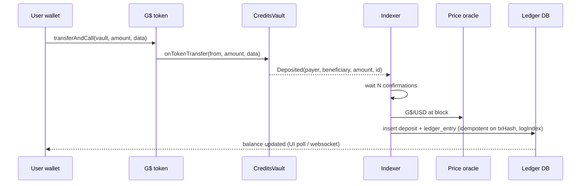

# GoodBuild credits system (design)

Status: design only, 4 Nov 2026. This is the user's decision (D11): GoodBuild runs its **own** credit system, because GoodDollar's AI credits have no usable API yet (see [GOODDOLLAR_AI_CREDITS.md](GOODDOLLAR_AI_CREDITS.md)). Everything below is **proposed** unless it says otherwise. Challenge anything: each open point has a Claude's input placeholder or links to [OPEN_QUESTIONS.md](OPEN_QUESTIONS.md) Q18–Q22.

## 1. Overview
```text
G$ (Celo) -> GoodBuildCreditsVault -> Deposited event -> indexer -> ledger (USD micro-units)
                                                                   -> LiteLLM spend (per user key/budget) -> providers
Treasury: vault G$ -> swap to USD (cUSD/USDC) -> pay provider bills
```
- Credit unit (proposed): **1 credit = 1 micro-USD** in storage. The UI shows dollars, for example "$4.20 of AI left". Q18.
- Credits cannot be transferred and are not money. They are prepaid usage.

## 2. On-chain deposit (Celo)
- **Primary path:** ERC-677 `G$.transferAndCall(vault, amount, data)`, which is one transaction. GoodDollar's own vault uses this pattern ([antseed-integration](https://github.com/GoodDollar/antseed-integration/blob/e8c46a8/docs/USER_GUIDE.md)). In our version, `data` is empty or `abi.encode(beneficiary)`.
- **Fallback:** `approve` plus `deposit(amount, beneficiary)`, for wallets that can't call `transferAndCall`.
- **Later:** G$ streaming through Superfluid (vault as a SuperApp, or a cron job that reads stream periods). This adds complexity (callbacks, jail risk, accounting bugs such as [antseed-integration#27](https://github.com/GoodDollar/antseed-integration/issues/27)), so it is **not in the MVP**.
- The vault only holds and forwards funds. Credits are computed off-chain (§3), so prices never touch the contract.

### Interface sketch
```solidity
interface IGoodBuildCreditsVault {
    event Deposited(address indexed payer, address indexed beneficiary, uint256 amount, bytes32 indexed depositId);
    event TreasuryWithdrawn(address indexed to, uint256 amount);

    // ERC-677 hook; only callable by the G$ token
    function onTokenTransfer(address from, uint256 amount, bytes calldata data) external returns (bool);
    // approve + deposit fallback
    function deposit(uint256 amount, address beneficiary) external;
    // treasury (multisig only), for swaps/provider bills
    function withdrawToTreasury(address to, uint256 amount) external;
    function pause() external; function unpause() external;
}
```
- `depositId = keccak256(chainId, txHash-equivalent nonce)`. Simplest: a contract counter. The off-chain idempotency key is `(chainId, txHash, logIndex)`.
- Proposed: non-upgradeable, OpenZeppelin `Ownable2Step` + `Pausable` + `ReentrancyGuard`, owned by a Safe multisig. A minimum deposit (for example 1,000 G$) prevents dust spam. This fits P2 in [CONTRACTS_AND_DEPLOYMENT.md](CONTRACTS_AND_DEPLOYMENT.md).
- G$ address on Celo: take it from GoodProtocol `deployment.json` at build time. (UNVERIFIED here; `0x62B8…9c7A` is the address GoodDollar's antseed-integration uses as the G$ SuperToken.)

## 3. Off-chain ledger
- The **indexer** watches `Deposited` logs (viem `watchContractEvent` plus a backfill from the last processed block) and waits for confirmations (Celo finality is fast; proposed: wait for N=3 blocks).
- **Price source (proposed):** the GoodDollar reserve / static oracle price for G$ (the source antseed-integration uses, `CELO_STATIC_ORACLE_ADDRESS`). Fallbacks: a TWAP from Uniswap/Ubeswap pools, or CoinGecko. If both sources fail or disagree by more than 5%, the indexer holds the deposit as `pending_price`. Q19. Claude's input: _TBD_
- **Snapshot:** store `gd_usd_price`, `price_source` and `price_block` on each deposit. The credit amount is fixed at the moment of deposit.
- Idempotency: unique `(chain_id, tx_hash, log_index)`. A replayed log is a no-op.
- The ledger is **append-only double entry**. Balance = sum of entries, cached in `balances` and updated in the same DB transaction.

### Tables (Postgres)
| Table | Key columns |
|---|---|
| `users` | id, wallet (unique), goodid_root, verified_at, country_ok, age_ok, created_at |
| `deposits` | id, user_id, chain_id, tx_hash, log_index (unique triple), gd_amount_wei, gd_usd_price, price_source, price_block, usd_micro, status (`pending_price`/`credited`/`flagged`) |
| `ledger_entries` | id, user_id, kind (`deposit`/`bonus`/`free_tier`/`usage`/`refund`/`adjust`), amount_micro (+/-), ref_type, ref_id, idempotency_key (unique), created_at |
| `balances` | user_id, balance_micro, reserved_micro, updated_at |
| `usage_events` | id, user_id, litellm_call_id (unique), model, input_tokens, output_tokens, provider_cost_micro, charged_micro, markup_bps |
| `llm_keys` | user_id, litellm_key_id, max_budget, status |
| `treasury_ops` | id, kind (`swap`/`provider_payment`), gd_wei, usd_micro, tx_hash, notes |

## 4. Spending (AI SDK, D18)
Two options. Proposed: **B, with a preflight reserve**. Q20. Claude's input: _TBD_
- **A. A LiteLLM virtual key per user with `max_budget`.** After each deposit, top the key up with `/key/update` to the new budget. This is simple, but LiteLLM tracks the budget at provider cost, so a markup needs extra work, and the ledger becomes a second source of truth.
- **B. A single internal key, debiting from our own code** (D18: this now lives in `recordUsage`, using token usage from the AI SDK and `src/config/model-pricing.ts`, no LiteLLM callback). It debits `charged = provider_cost × (1 + markup)`, idempotent on `litellm_call_id`. The ledger stays the only source of truth.
- **Preflight:** before each agent turn, estimate the worst-case cost (`max_tokens` × output price plus the input) and **reserve** it (`reserved_micro`). Refuse with "top up" if `balance − reserved < estimate`. After the call, settle the reservation to the actual cost.
- **Streaming cutoff:** track output tokens while streaming. If the running cost would exceed the reservation, stop the stream, finish the turn cleanly, and offer a top-up. Always cap `max_tokens` from the available balance.
- **Markup (proposed):** 20–30% to cover price swings, swap fees and infrastructure. Q21. Claude's input: _TBD_
- **Overdraft:** allowed only up to the reservation. Any small negative balance from estimation error is absorbed (written off as `adjust`).

## 5. Free tier and GoodID bonus (optional)
- **Now decided:** D28 ($0.20 per account), D29 (total budget) and D30 ($0.50 more once per verified person) in [DECISIONS.md](DECISIONS.md) replace the proposal below.
- Proposed: the **free tier** gives $0.50 of credits once per GoodID root, and only to GoodID-verified users (`getWhitelistedRoot` on Celo GoodID `0xC361…2F42`, per [antseed-integration wrangler.toml](https://github.com/GoodDollar/antseed-integration/blob/e8c46a8/backend/wrangler.toml)). This stops sybil farming.
- Optional deposit bonus for verified users, for example +10% with a monthly cap per root. This mirrors GoodDollar's model, but the amounts are ours. Claude's input: _TBD_

## 6. Policies
- **Withdrawals/refunds (proposed):** credits are non-refundable by default. Exceptions: deposits stuck in `pending_price`/`flagged`, or credit failures, are refunded in G$ to the payer. Unused paid balance can be refunded on request within 30 days, at the snapshot price, minus fees, with no refund of bonus or free credits. Q22. Claude's input: _TBD_
- **Treasury:** a multisig (Safe) withdraws G$ from the vault and swaps it to cUSD/USDC (Mento or a DEX; route UNVERIFIED), then pays provider bills in fiat or USDC. Proposed: swap weekly or whenever the G$ held is more than about 2 weeks of spend, and keep a USD buffer of 1 month of bills. Log every operation in `treasury_ops`.
- **Abuse limits:** a per-user daily spend cap (for example $5 a day by default), rate limits on requests, a cap on concurrent agent runs, and flags for anomalies (new wallet plus a large deposit plus heavy use). Free credits never go to an unverified wallet.
- **Eligibility:** 18+ and **no US persons** (D10, GoodDollar ToS §6.2/§8), plus exclusion of sanctioned jurisdictions. Users attest at signup, IP geo-blocking is applied, and the deposit UI refuses if the user hasn't attested.

## 7. Sequence diagrams

```mermaid
sequenceDiagram
  participant A as GoodBuild agent
  participant B as Billing service
  participant LL as LiteLLM
  participant M as Model provider
  A->>B: preflight(user, est_cost)
  B-->>A: reservation id or "top up"
  A->>LL: completion(stream, max_tokens capped)
  LL->>M: request
  M-->>LL: tokens (stream)
  LL-->>A: tokens; A cuts stream if over reservation
  LL->>B: success callback (call_id, response_cost)
  B->>B: debit cost*(1+markup), release reservation
```

## 8. MVP vs later
| MVP (Stage 1) | Later |
|---|---|
| transferAndCall + approve/deposit vault on Celo Sepolia, then mainnet | Superfluid streaming credits |
| Indexer + Postgres ledger, single price source + snapshot | Multi-source/TWAP price, automated swaps |
| LiteLLM callback debit + preflight reserve + max_tokens cap | Per-user virtual keys, team/org budgets |
| Free tier for GoodID-verified | Deposit bonuses, referral credits |
| Manual treasury swaps by multisig | GoodDollar/AntSeed as optional provider (P3 deferred) |

## 9. Risks
- **G$ price volatility:** the price is snapshotted at deposit, but treasury conversion happens later and the price may have dropped. Mitigations: markup, frequent swaps, and a minimum price floor or pause.
- **Liquidity:** G$ to USD depth on Celo may be thin, so large swaps slip. Check pool depth before setting deposit caps (UNVERIFIED).
- **Oracle manipulation or outage:** hold deposits as `pending_price`, sanity-bound against a second source.
- **Accounting bugs:** keep the ledger double-entry, idempotency keys and reconciliation jobs (vault balance vs credited deposits).
- **Regulatory:** prepaid credits might count as stored value. Keep them non-transferable, keep refunds limited, and get legal review (UNVERIFIED).
- **Key/contract risk:** a multisig owner, the pause switch, and an audit or Slither run before mainnet.

## On-chain credits (D51 to D55)
Credits can also be bought with CELO on Celo mainnet. The GoodBuildCredits token (1 unit = 1 micro-USD, not transferable) is burned on `redeem`, and the server posts the same amount to the ledger as a `deposit` keyed `onchain:<chain>:<tx>:<logIndex>`. The ledger, holds and free caps (D46 to D49) are unchanged. See DECISIONS D51 to D55.
